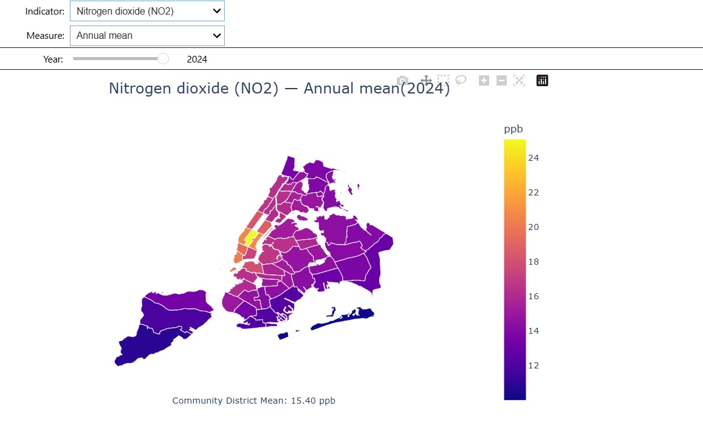
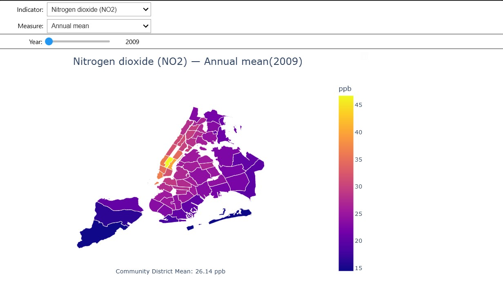
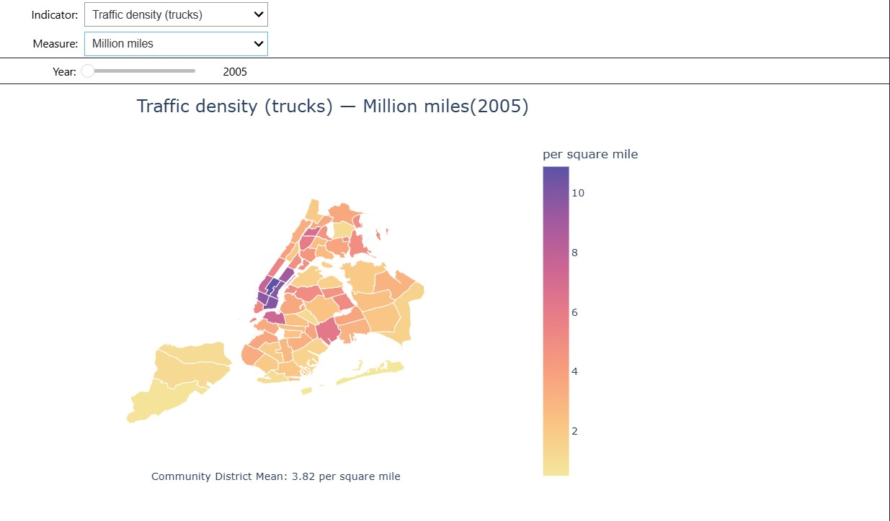
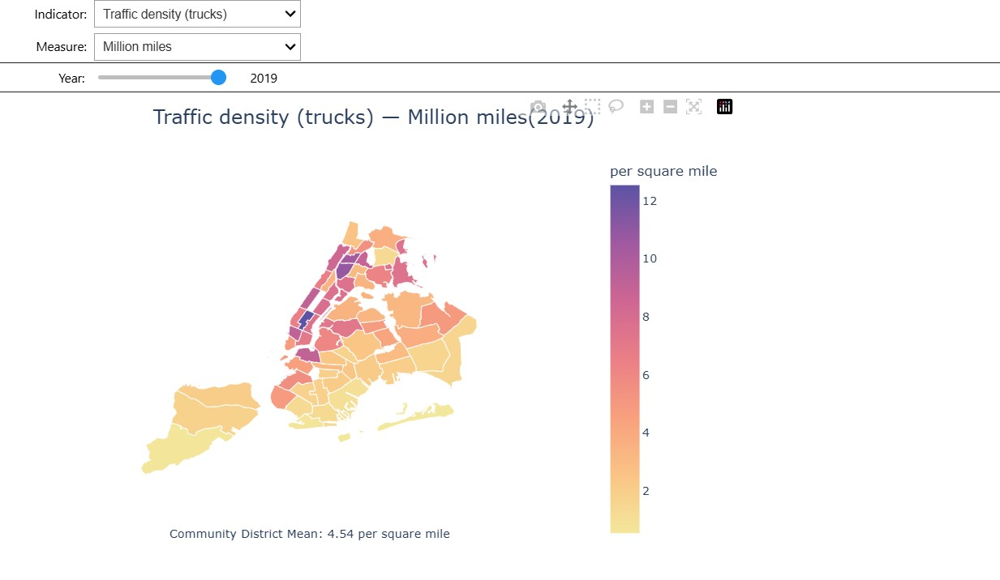

# NYC AQI Heatmap Analysis

An interactive map of air quality across New York City's 59 community districts. Pick an indicator and a measure, then use the slider to move through the years and explore your neighborhoods air quality. Built in Python with pandas and Plotly in a Jupyter notebook.

| | |
|---|---|
|  |  |

## Findings

- PM2.5 fell 40% citywide, from 11.03 in 2009 to 6.65 in 2024.
- NO2 fell 41% , from 26.14 to 15.40.
- Ozone went up 35%, from 24.62 to 33.31 (summer mean). One likely reason is that less NO2 means less NO in the air to break ozone down.
- Midtown is the most polluted district for PM2.5 (10.5) and NO2 (25.1) in 2024. The Rockaways and the Queens and Staten Island edges are the cleanest.
- Ozone is the reverse: it is highest in the Rockaways, Coney Island and Canarsie, and lowest in Midtown.

| | |
|---|---|
|  |  |

## Process

1. Loaded the NYC Open Data air quality file and kept the community district rows.
2. Cleaned it: stripped text, fixed dates and numbers, dropped missing values and duplicates, and ran checks (no negative values, every district ID matches the map file).
3. Drew a Plotly choropleth over the NYC community district boundaries.
4. Added dropdowns and a year slider (ipywidgets) so the map redraws as you change them.

## Technologies

- Python
- pandas
- Plotly
- ipywidgets
- GeoJSON
- Jupyter Notebook (VS Code)

## Data

[NYC Open Data: Air Quality](https://data.cityofnewyork.us/) (NYC Department of Health and Mental Hygiene). Years available: 2005 and 2009-2024, depending on the indicator.